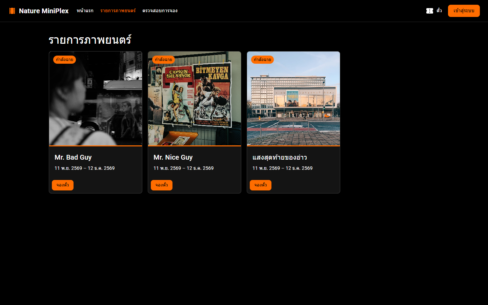
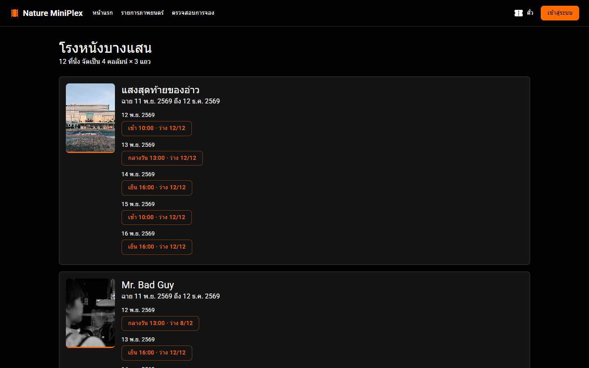
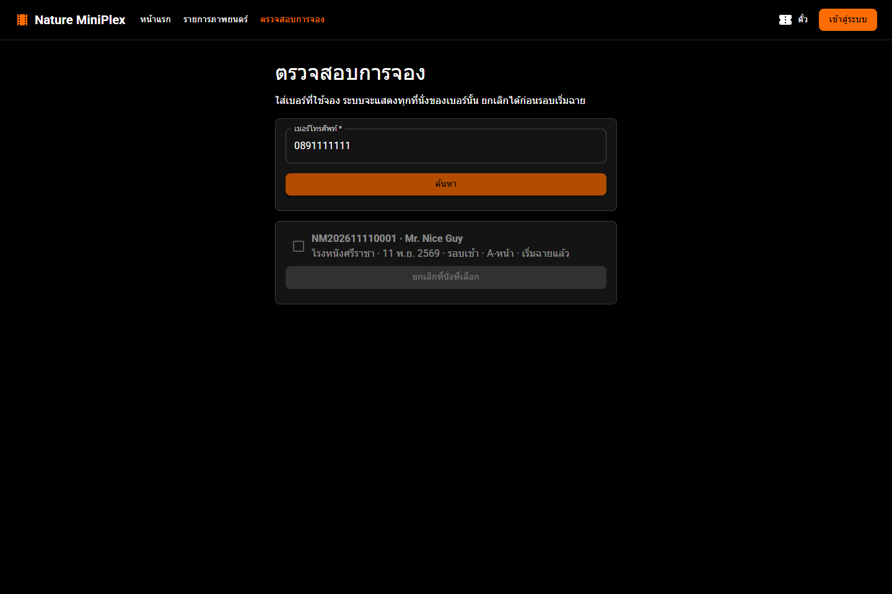
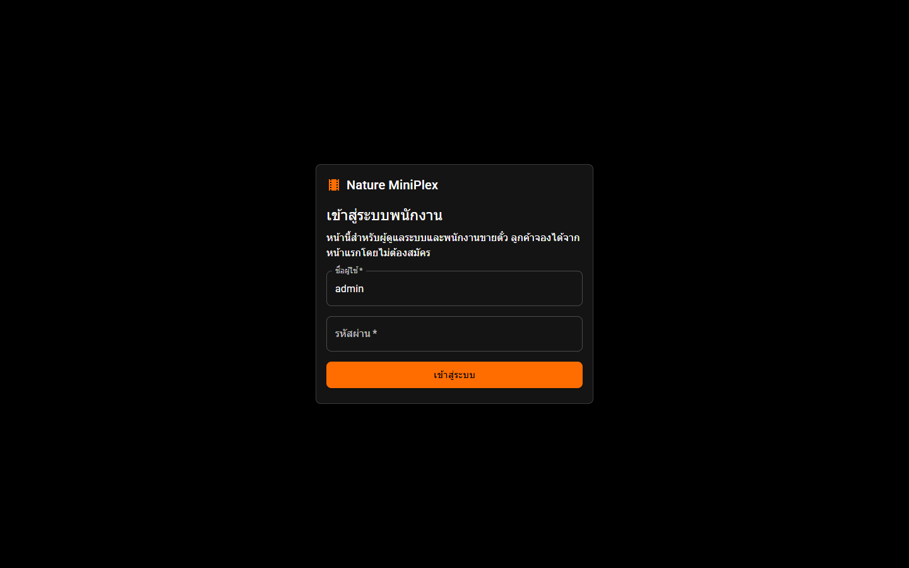
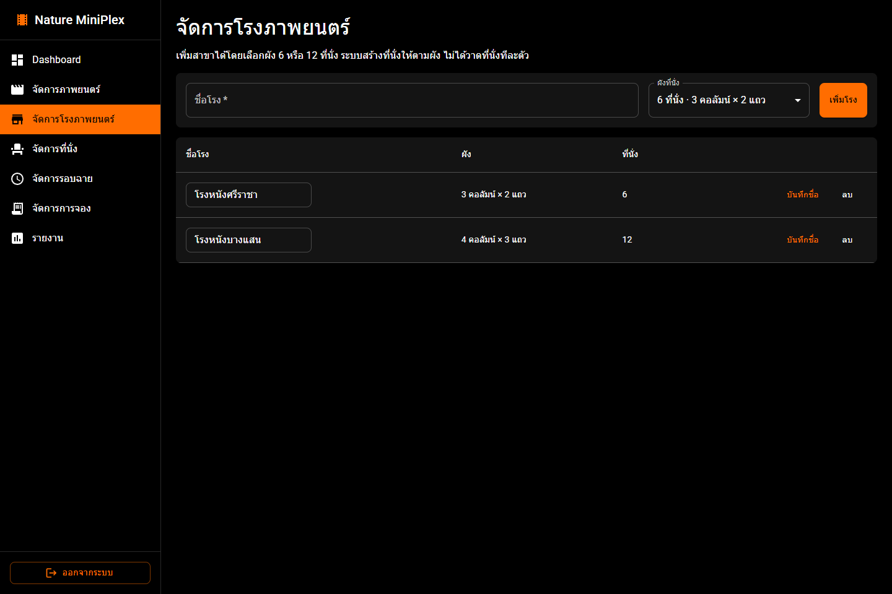
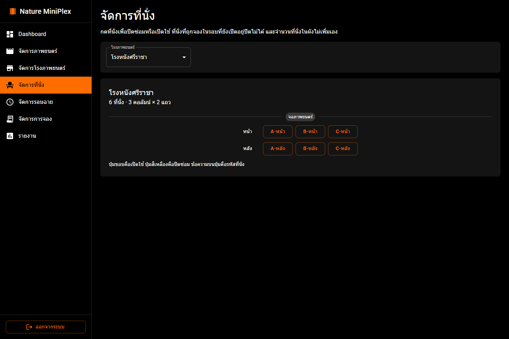
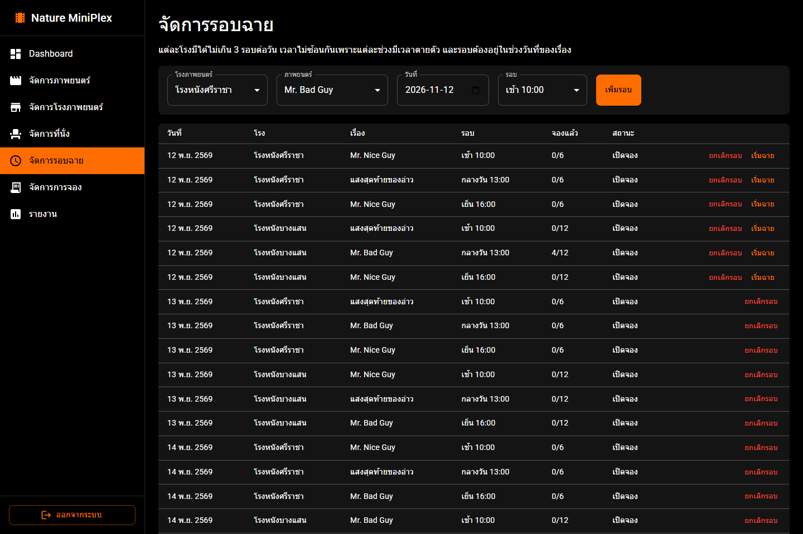
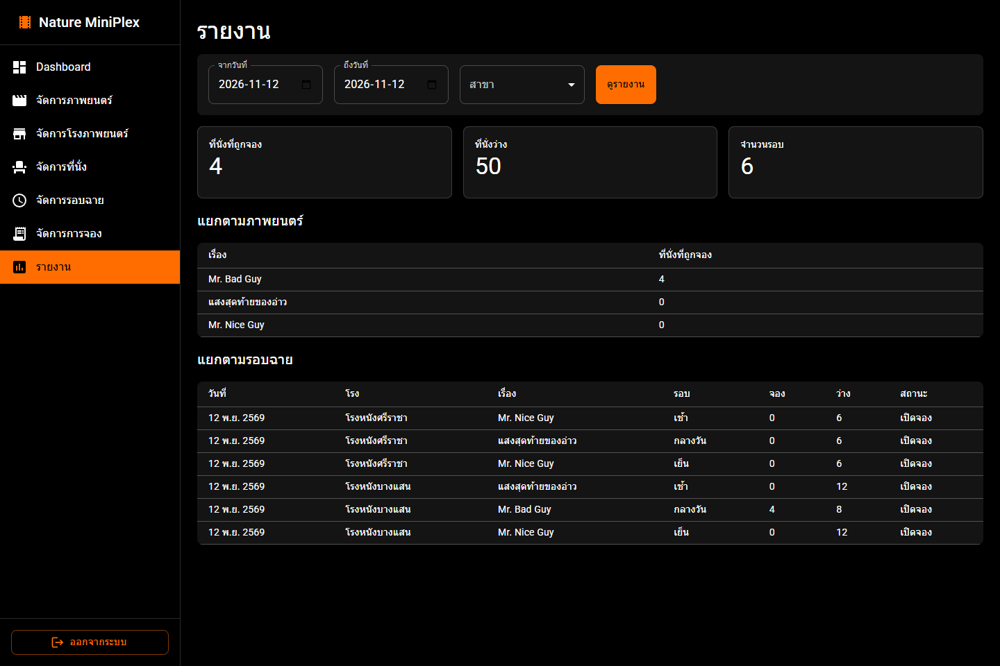

# Nature MiniPlex

ระบบจองตั๋วหนังสองฝั่งในเว็บเดียว ลูกค้าเลือกเรื่อง โรง รอบ และที่นั่งได้เองโดยไม่ต้องสมัครสมาชิก พนักงานเข้าสู่ระบบเพื่อจัดการเรื่อง โรง ที่นั่ง รอบฉาย และการจอง แล้วดูรายงานจากข้อมูลจริงในฐานข้อมูล

หน้าเว็บเป็น React กับ Material UI โทนดำ ขาว และส้ม หลังบ้านเป็น ASP.NET Core Web API เรียกผ่าน Service แล้วบันทึกด้วย Entity Framework Core ลง SQL Server Express


## สารบัญ

- [ลูกค้าใช้งานอย่างไร](#ลูกค้าใช้งานอย่างไร)
- [พนักงานใช้งานอย่างไร](#พนักงานใช้งานอย่างไร)
- [สิ่งที่ต้องติดตั้ง](#สิ่งที่ต้องติดตั้ง)
- [รันบนเครื่องตัวเอง](#รันบนเครื่องตัวเอง)
- [ข้อมูลตัวอย่างและบัญชีพนักงาน](#ข้อมูลตัวอย่างและบัญชีพนักงาน)
- [ถ้าเปิดแล้วไม่ขึ้น](#ถ้าเปิดแล้วไม่ขึ้น)
- [กติกาของระบบ](#กติกาของระบบ)
- [จะแก้หรือทำต่อที่ไฟล์ไหน](#จะแก้หรือทำต่อที่ไฟล์ไหน)
- [โครงโฟลเดอร์](#โครงโฟลเดอร์)
- [API](#api)
- [ทดสอบ](#ทดสอบ)
- [ขอบเขตของระบบ](#ขอบเขตของระบบ)

## ลูกค้าใช้งานอย่างไร

ลูกค้าเปิด http://localhost:5173 ได้เลย ไม่มีบัญชีลูกค้า ปุ่ม **เข้าสู่ระบบ** ที่หัวเว็บเป็นของพนักงาน

หน้าแรกเลื่อนหนังที่กำลังฉายทุก 6 วินาที แล้วแบ่งเป็นสี่ส่วน

- **ภาพยนตร์แนะนำ** คือเรื่องที่พนักงานติ๊กไว้
- **ภาพยนตร์ที่กำลังฉาย** คือเรื่องที่ยังไม่ยกเลิก และวันนี้ยังอยู่ในช่วงฉาย
- **รอบฉายวันนี้** คือรอบที่ยังเปิดจอง พร้อมจำนวนที่นั่งว่าง
- **สาขาโรงภาพยนตร์** คือโรงศรีราชา 6 ที่นั่ง และโรงบางแสน 12 ที่นั่ง



กดสาขาแล้วจะเห็นเรื่องที่มีรอบเปิดจองของโรงนั้น ปุ่มเวลาพาไปเลือกที่นั่ง ถ้าโรงยังไม่มีรอบ หน้านี้จะบอกครั้งเดียวว่าสาขานี้ยังไม่มีรอบที่เปิดจอง



ผังที่นั่งใช้รหัสเต็ม เช่น `A-หน้า` ปุ่มขอบส้มคือที่ว่าง ปุ่มส้มทึบคือที่เลือกไว้ ปุ่มเทาคือมีคนจองแล้ว ปุ่มเหลืองคือปิดซ่อมและกดไม่ได้ เลือกได้ 1 ถึง 4 ที่นั่งในการจองครั้งเดียว และข้ามรอบหรือข้ามเรื่องได้ รายการที่เลือกอยู่ในเบราว์เซอร์ก่อน กดยืนยันแล้วเซิร์ฟเวอร์ตรวจฐานข้อมูลอีกครั้ง


หลังจอง ระบบออกรหัสรูปแบบ `NM` ตามด้วยวันที่และเลขการจอง ลูกค้าไม่ต้องจำรหัสนี้ หน้าตรวจสอบการจองค้นด้วยเบอร์โทร 10 หลักที่ขึ้นต้นด้วย 0 อย่างเดียว ใส่ขีดหรือเว้นวรรคได้ ระบบตัดเหลือตัวเลขให้ ยกเลิกได้เฉพาะที่นั่งของเบอร์นั้น และยกเลิกไม่ได้ถ้ารอบเริ่มฉายแล้วหรือวันฉายผ่านไปแล้ว



## พนักงานใช้งานอย่างไร

เปิด http://localhost:5173/admin/login หรือกด **เข้าสู่ระบบ** ชื่อผู้ใช้เริ่มต้นคือ `admin` รหัสคือ `Admin@1234` รหัสนี้มีไว้ให้เปิดเครื่องพัฒนาได้ทันที ระบบออก JWT อายุ 8 ชั่วโมง เก็บในเบราว์เซอร์ และใช้กับเมนูพนักงานเท่านั้น



หลังเข้าสู่ระบบมีเจ็ดเมนู

| เมนู | ทำอะไร |
|---|---|
| Dashboard | สรุปที่นั่งที่ถูกจองวันนี้ จำนวนรอบ และรายการจองล่าสุด |
| จัดการภาพยนตร์ | เพิ่ม แก้ไข อัปโหลดโปสเตอร์ ติ๊กเรื่องแนะนำ และยกเลิกเรื่อง |
| จัดการโรงภาพยนตร์ | เพิ่มโรงโดยเลือกผัง 6 หรือ 12 ที่นั่ง เปลี่ยนชื่อ และลบโรงที่ยังไม่มีรอบ |
| จัดการที่นั่ง | กดที่นั่งเพื่อปิดซ่อมหรือเปิดใช้ ที่นั่งที่ถูกจองในรอบที่ยังเปิดอยู่ปิดไม่ได้ |
| จัดการรอบฉาย | เพิ่มทีละรอบ ไม่เกิน 3 รอบต่อโรงต่อวัน เปลี่ยนเรื่อง ยกเลิกรอบ หรือยืนยันเริ่มฉาย |
| จัดการการจอง | ดูที่นั่งที่ยังจองอยู่ ค้นด้วยเบอร์แล้วจะเห็นประวัติที่ยกเลิกของเบอร์นั้นด้วย |
| รายงาน | สรุปรอบและจำนวนที่นั่งตามช่วงวันที่กับสาขาที่เลือก |


โปสเตอร์รับไฟล์ jpg, png หรือ webp ไม่เกิน 2 MB ไฟล์อยู่ที่ `src/NatureMiniPlex.Web/wwwroot/posters` ฐานข้อมูลเก็บแค่ชื่อไฟล์ เรื่องที่ไม่มีโปสเตอร์ยังจองได้ การ์ดจะเป็นพื้นดำหรือขาว





สี่ช่วงเวลาตายตัวจึงไม่ชนกัน

| ช่วง | เวลา |
|---|---|
| เช้า | 10:00 |
| กลางวัน | 13:00 |
| เย็น | 16:00 |
| ดึก | 20:00 |

หนึ่งโรงในหนึ่งวันมีได้อย่างมาก 3 รอบ นับรอบที่เริ่มฉายแล้วด้วย รอบที่ยกเลิกแล้วเอาช่องเวลานั้นกลับมาใช้ใหม่ได้ เปลี่ยนเรื่องหรือยกเลิกรอบไม่ได้ถ้ามีที่นั่งจองอยู่หรือเริ่มฉายแล้ว ยืนยันเริ่มฉายได้เมื่อถึงวันฉาย หลังจากนั้นรอบนั้นจองและยกเลิกไม่ได้



รายงานอ่านจากฐานข้อมูลทุกครั้งที่กดดู ไม่มีตารางสรุปที่บันทึกไว้ล่วงหน้า



## สิ่งที่ต้องติดตั้ง

ตรวจสามอย่างนี้ก่อน เวอร์ชันที่ใช้พัฒนาคือ .NET SDK 10, Node.js 20 ขึ้นไป และ Docker ที่รัน SQL Server 2022 ได้

```text
dotnet --version
node --version
docker info
```

`dotnet --version` ต้องขึ้นต้นด้วย `10` ถ้า `docker info` ต่อไม่ติด ให้เปิด Docker Desktop ก่อน แล้วรอจนคำสั่งนี้ตอบได้

## รันบนเครื่องตัวเอง

ทำจากโฟลเดอร์รากของโปรเจกต์ โฟลเดอร์ที่มี `docker-compose.yml`

1. เปิด SQL Server Express

```text
docker compose up -d
```

คอนเทนเนอร์ชื่อ `natureminiplex-sql` เปิดพอร์ต `1433` รหัส `sa` คือ `NatureMiniPlex!2026` ใช้ในเครื่องพัฒนาเท่านั้น

2. ครั้งแรกที่โคลนโปรเจกต์ ให้ติดตั้งเครื่องมือ migration

```text
dotnet tool restore
```

คำสั่งนี้ลง `dotnet-ef` 10.0.7 ตามไฟล์ `.config/dotnet-tools.json` ใช้ตอนเพิ่ม migration ใหม่ ตอนเปิดเว็บครั้งแรกไม่จำเป็นต้องเรียกเอง เพราะ API สร้างตารางให้

3. เปิด API

```text
dotnet run --project src/NatureMiniPlex.Web --launch-profile http
```

รอจนขึ้น `Now listening on: http://localhost:5274` ครั้งแรกที่ฐานข้อมูลว่าง โปรแกรมสร้างตาราง ใส่โรง หนัง รอบ และพนักงานตัวอย่างให้เอง ถ้า SQL ยังไม่พร้อม API จะลองใหม่ 15 ครั้ง ครั้งละ 2 วินาที

ใช้โปรไฟล์ `http` นี้เท่านั้น หน้าเว็บส่ง `/api` ไปที่พอร์ต 5274 แบบ HTTP

4. เปิดเทอร์มินัลอีกอันที่โฟลเดอร์ `frontend`

```text
cd frontend
npm install
npm run dev
```

`npm install` ทำครั้งแรกครั้งเดียว จากนั้นรอจนขึ้น `Local: http://localhost:5173/`

5. เปิดเบราว์เซอร์

| ที่ | URL |
|---|---|
| เว็บลูกค้า | http://localhost:5173 |
| เข้าสู่ระบบพนักงาน | http://localhost:5173/admin/login |
| Swagger | http://localhost:5274/swagger |

เปิดแค่ API แล้วยังไม่เห็นหน้าเว็บ หน้า React มาจาก Vite อีกโปรเซสหนึ่ง Swagger ใช้ลอง API ได้ และปุ่ม Authorize รับ token จาก `POST /api/auth/login` โดยไม่ต้องพิมพ์คำว่า Bearer

## ข้อมูลตัวอย่างและบัญชีพนักงาน

ข้อมูลชุดนี้ถูกใส่เมื่อฐานข้อมูลยังไม่มีหนัง ไม่มีโรง หรือยังไม่มีผู้ใช้ ถ้ามีข้อมูลอยู่แล้ว การเปิด API ซ้ำจะไม่เขียนทับ

- โรงหนังศรีราชา 6 ที่นั่ง คอลัมน์ A B C แถวหน้ากับหลัง
- โรงหนังบางแสน 12 ที่นั่ง คอลัมน์ A ถึง D แถวหน้า กลาง และหลัง
- เรื่องตัวอย่างห้าเรื่องฉายตั้งแต่วันที่เปิดโปรแกรมครั้งแรกไปอีก 21 วัน คือ Mr. Nice Guy, Mr. Bad Guy, แสงสุดท้ายของอ่าว, คืนที่บางแสนไม่หลับ และ เพื่อนบ้านข้างโรงหนัง
- Mr. Nice Guy กับ แสงสุดท้ายของอ่าว ถูกติ๊กเป็นเรื่องแนะนำ
- ทั้งสองโรงมีรอบเปิดจองในห้าวันแรก วันละ 3 รอบ
- ที่นั่ง `A-หน้า` ของศรีราชา รอบเช้าวันแรก ถูกจองด้วยเบอร์ `0891111111`
- พนักงานชื่อ `admin` รหัส `Admin@1234`

วันที่ในช่องกรอกเป็น ค.ศ. เช่น `2026-11-12` วันที่ที่โชว์ในการ์ดและตารางเป็น พ.ศ. โปสเตอร์ไม่มีใน Git เพราะเป็นไฟล์ที่พนักงานอัปโหลดบนเครื่องตัวเอง โคลนมาใหม่แล้วการ์ดยังใช้ได้ รูปจะมาเมื่ออัปโหลดจากเมนูจัดการภาพยนตร์

รหัส `sa`, คีย์ JWT และรหัสพนักงานอยู่ใน `docker-compose.yml` กับ `appsettings.json` เพื่อให้รันได้ทันที ใช้กับเครื่องพัฒนาเท่านั้น ถ้าจะเปลี่ยนรหัส `sa` ให้แก้สามจุดให้ตรงกัน คือ `docker-compose.yml`, `ConnectionStrings:Default` ใน `appsettings.json` และสายเชื่อมใน `tests/NatureMiniPlex.Tests/BookingRuleTests.cs`

## ถ้าเปิดแล้วไม่ขึ้น

**Docker ต่อไม่ติด**  
เปิด Docker Desktop แล้วรอจน `docker info` ตอบได้ จากนั้นรัน `docker compose up -d` อีกครั้ง

**พอร์ต 1433 ถูกใช้แล้ว**  
เปลี่ยนพอร์ตฝั่งเครื่องใน `docker-compose.yml` จาก `"1433:1433"` เป็นพอร์ตว่าง เช่น `"1434:1433"` แล้วแก้ `Server=localhost,1433` ใน `appsettings.json` และในไฟล์เทสให้เป็นพอร์ตเดียวกัน

**เว็บเปิดได้แต่ไม่มีข้อมูล หรือขึ้นว่าต่อ API ไม่ได้**  
ดูเทอร์มินัลของ API ต้องฟังที่ http://localhost:5274 และดูเทอร์มินัลของ Vite ต้องเป็น http://localhost:5173 ถ้าเปิดคนละพอร์ต ตัว proxy ใน `frontend/vite.config.js` จะส่งไม่ถึง

**หน้าเว็บว่างหรือค้างหลังแก้โค้ดหน้าบ้าน**  
หยุด `npm run dev` แล้วสั่งใหม่ ถ้าเคยเจอโมดูลเก่าค้าง ให้ลบ `frontend/node_modules/.vite` ก่อนเริ่มใหม่

**แก้โค้ดหลังบ้านแล้วยังเป็นของเก่า**  
หยุด `dotnet run` ก่อน แล้วรันใหม่ บน Windows ถ้าไม่หยุด ไฟล์ `NatureMiniPlex.Web.exe` จะถูกล็อก และทั้ง `dotnet build` กับ `dotnet test` จะคอมไพล์ไม่ได้

**อยากได้ข้อมูลตัวอย่างชุดใหม่**  
ตัวใส่ข้อมูลจะไม่ทำงานซ้ำเมื่อมีหนังหรือโรงอยู่แล้ว ถ้าต้องการชุดเริ่มต้นจริง ๆ ให้หยุด API แล้วลบฐานข้อมูล `NatureMiniPlex` ใน SQL Server จากนั้นเปิด API ใหม่ อย่าลบฐาน `NatureMiniPlex_Test` ทิ้งโดยไม่จำเป็น เพราะเทสสร้างและล้างข้อมูลของตัวเองอยู่แล้ว

**เทสไม่ผ่านเพราะต่อ SQL ไม่ได้**  
เปิดคอนเทนเนอร์ก่อน เทสใช้ฐาน `NatureMiniPlex_Test` คนละก้อนกับข้อมูลบนเว็บ

## กติกาของระบบ

กติกาอยู่ที่ Service ไม่ได้อยู่ที่หน้าเว็บ หน้าเว็บส่งคำขออย่างเดียว

1. เพิ่มโรงได้สองผังเท่านั้น ผัง 6 ที่นั่งเป็น 3 คอลัมน์ 2 แถว ผัง 12 ที่นั่งเป็น 4 คอลัมน์ 3 แถว ระบบสร้างที่นั่งให้ทั้งผัง เปลี่ยนชื่อโรงได้ ลบโรงได้เมื่อยังไม่มีรอบฉาย
2. ปิดที่นั่งเพื่อซ่อมได้ แต่ปิดไม่ได้ถ้าที่นั่งนั้นถูกจองในรอบที่ยังเปิดอยู่และวันฉายยังไม่ผ่าน ที่นั่งปิดซ่อมจองไม่ได้ และไม่ถูกนับเป็นที่ว่าง
3. เรื่องหนังมีวันเริ่มและวันสิ้นสุด วันสิ้นสุดรวมอยู่ในช่วงฉาย รอบฉายต้องอยู่ในช่วงนี้ และเพิ่มย้อนหลังไม่ได้
4. หนึ่งโรงในหนึ่งวันมีได้อย่างมาก 3 รอบ จากสี่ช่วงเวลาตายตัว โรงเดียวกันใช้ช่วงเวลาซ้ำไม่ได้ คนละรอบในวันเดียวกันเป็นคนละเรื่องได้ ระบบไม่ได้สร้างรอบว่างให้ทุกวันในอนาคตเอง
5. แก้เรื่องของรอบ หรือยกเลิกรอบ ไม่ได้เมื่อรอบนั้นมีที่นั่งที่ยังจองอยู่ หรือเริ่มฉายแล้ว
6. หนึ่งการจองใช้หนึ่งเบอร์ ได้ 1 ถึง 4 ที่นั่ง ข้ามรอบและข้ามเรื่องได้ ที่นั่งหนึ่งของรอบหนึ่งมีเจ้าของได้คนเดียว ถ้ายกเลิกแล้ว ที่นั่งนั้นจองใหม่ได้
7. ยกเลิกได้เฉพาะที่นั่งของเบอร์นั้น ระบบเทียบเบอร์จากฐานข้อมูล
8. เมื่อถึงวันฉาย พนักงานยืนยันเริ่มฉายได้ หลังจากนั้นรอบนั้นจองและยกเลิกไม่ได้ วันฉายที่ผ่านไปแล้วปิดเอง แม้ยังไม่ได้กดยืนยัน
9. ยกเลิกเรื่องได้เมื่อไม่มีรอบของวันนี้หรือวันหน้าถูกจองหรือเริ่มฉาย รอบในอนาคตที่ยังว่างจะถูกยกเลิกตาม
10. การยกเลิกเปลี่ยนสถานะ ไม่ลบแถว เพื่อให้ประวัติยังอยู่ในรายงาน

## จะแก้หรือทำต่อที่ไฟล์ไหน

ชั้นของคำขอคือ Controller รับ HTTP แล้วส่งต่อ Service Service เป็นที่เดียวที่ตัดสินกติกา แล้ว EF Core เขียน SQL Server

| อยากแก้ | เปิดไฟล์ |
|---|---|
| กติกาจอง ยกเลิก และผังที่นั่งฝั่งลูกค้า | `src/NatureMiniPlex.Web/Services/BookingService.cs` |
| กติการอบฉาย | `src/NatureMiniPlex.Web/Services/ScheduleService.cs` |
| เพิ่มโรง เปลี่ยนชื่อ ลบโรง และปิดที่นั่ง | `src/NatureMiniPlex.Web/Services/CinemaService.cs` |
| เรื่องหนังและเรื่องแนะนำ | `src/NatureMiniPlex.Web/Services/MovieService.cs` |
| ไฟล์โปสเตอร์ | `src/NatureMiniPlex.Web/Services/PosterFiles.cs` |
| ตรวจรหัสพนักงาน | `src/NatureMiniPlex.Web/Services/AuthService.cs` และ `PasswordHasher.cs` |
| รายงานและแดชบอร์ด | `src/NatureMiniPlex.Web/Services/ReportService.cs` |
| รูปร่างคำขอและคำตอบของ API | `src/NatureMiniPlex.Web/DTOs` |
| ตารางและคอลัมน์ | `src/NatureMiniPlex.Web/Models` แล้วเพิ่ม migration |
| ข้อมูลตัวอย่าง | `src/NatureMiniPlex.Web/Data/DbSeeder.cs` |
| หน้าลูกค้า | `frontend/src/pages/customer` |
| หน้าพนักงาน | `frontend/src/pages/admin` |
| สีและฟอนต์ | `frontend/src/theme.js` |
| เรียก API จากหน้าเว็บ | `frontend/src/services/api.js` |
| ล็อกกติกาด้วยเทส | `tests/NatureMiniPlex.Tests/BookingRuleTests.cs` |

ตะกร้าที่นั่งอยู่ที่ `localStorage` คีย์ `nmp-cart` token ของพนักงานอยู่ที่คีย์ `nmp-token` ทั้งสองอย่างยังไม่ใช่การจอง จนกว่าลูกค้ากดยืนยันและ `BookingService.BookAsync` บันทึกสำเร็จ

ถ้าเพิ่มคอลัมน์หรือตาราง ให้แก้โมเดลกับ `AppDbContext` แล้วสร้าง migration จากโฟลเดอร์ราก

```text
dotnet tool restore
dotnet ef migrations add ชื่อการเปลี่ยนแปลง --project src/NatureMiniPlex.Web
```

เปิด API ครั้งถัดไป โปรแกรมเรียก migration ให้เอง ไม่ต้องอัปเดตฐานด้วยมือ

กติกาใหม่ควรมีเทสหนึ่งกรณีใน `BookingRuleTests` เทสเรียก Service โดยตรง ไม่ผ่านหน้าเว็บ จึงยังล็อกกฎอยู่แม้จะเปลี่ยนปุ่มหรือข้อความ

## โครงโฟลเดอร์

```text
frontend/                         หน้าเว็บ React
  src/pages/customer/             หน้าลูกค้า
  src/pages/admin/                หน้าพนักงาน
  src/components/                 การ์ดหนัง ผังที่นั่ง หัวเว็บ และเมนูพนักงาน
  src/services/                   เรียก API และจัดรูปแบบวันที่
src/NatureMiniPlex.Web/           API
  Controllers/                    รับคำขอและส่งต่อ Service
  Services/                       กติกาธุรกิจ
  Models/                         เอนทิตี ผังที่นั่ง และผลลัพธ์ของกติกา
  DTOs/                           คำขอและคำตอบของ API
  Data/                           DbContext, migration และข้อมูลตัวอย่าง
  wwwroot/posters/                ไฟล์โปสเตอร์บนเครื่องที่รัน API
tests/NatureMiniPlex.Tests/       เทสกติกา
docs/DESIGN.md                    เอกสารออกแบบให้ตรงกับโค้ด
docs/screenshots/                 รูปใน README นี้
```

## API

คำตอบเป็น JSON ชื่อฟิลด์ขึ้นต้นด้วยตัวพิมพ์เล็ก และค่า enum เป็นข้อความ เช่น `"Morning"` ไม่ใช่ตัวเลข เส้นทางที่ต้องเป็นพนักงานต้องส่งหัว `Authorization` เป็น token ที่ได้จาก login

เส้นทางที่เปิดสาธารณะ

| คำสั่ง | เส้นทาง | ใช้ทำอะไร |
|---|---|---|
| GET | `/api/movies/showing` | เรื่องที่ลูกค้าเห็น |
| GET | `/api/movies/{id}` | รายละเอียดหนึ่งเรื่อง |
| GET | `/api/cinemas` | รายชื่อโรง |
| GET | `/api/cinemas/{id}/seats` | ผังที่นั่งของโรง |
| GET | `/api/showtimes?from&to&cinemaId&movieId` | รอบในช่วงวันที่ |
| GET | `/api/showtimes/{id}/seats` | ผังที่นั่งของรอบนั้น |
| POST | `/api/bookings` | จอง `{ phone, seats: [{ showtimeId, seatId }] }` |
| GET | `/api/bookings?phone=` | ค้นที่นั่งของเบอร์นั้น |
| POST | `/api/bookings/cancel` | ยกเลิก `{ phone, bookingSeatIds }` |
| POST | `/api/auth/login` | เข้าสู่ระบบพนักงาน ได้ token กลับมา |

เส้นทางของพนักงาน

| คำสั่ง | เส้นทาง | ใช้ทำอะไร |
|---|---|---|
| GET, POST, PUT | `/api/movies` | ดูทั้งหมด เพิ่ม และแก้ไข |
| POST | `/api/movies/{id}/cancel` | ยกเลิกเรื่อง |
| POST | `/api/movies/{id}/poster` | อัปโหลดโปสเตอร์ ฟิลด์ไฟล์ชื่อ `file` |
| POST, PUT, DELETE | `/api/cinemas` | เพิ่ม เปลี่ยนชื่อ และลบโรง |
| PUT | `/api/cinemas/{id}/seats/{seatId}` | ปิดหรือเปิดที่นั่ง `{ closed: true }` |
| POST, PUT | `/api/showtimes` | เพิ่มรอบ และเปลี่ยนเรื่องของรอบ |
| POST | `/api/showtimes/{id}/cancel` | ยกเลิกรอบ |
| POST | `/api/showtimes/{id}/start` | ยืนยันเริ่มฉาย |
| GET | `/api/dashboard` | ตัวเลขบนแดชบอร์ด |
| GET | `/api/reports?from&to&cinemaId` | รายงานตามช่วงวันที่ |

รายละเอียดฟิลด์ที่ Swagger สร้างจากโค้ดอยู่ที่ http://localhost:5274/swagger หลังเปิด API แล้ว

## ทดสอบ

เปิด SQL Server ตามขั้นด้านบนก่อน แล้วรันจากโฟลเดอร์ราก

```text
dotnet test tests/NatureMiniPlex.Tests/NatureMiniPlex.Tests.csproj
```

เทสอยู่ใน `BookingRuleTests.cs` ใช้ฐาน `NatureMiniPlex_Test` และล้างข้อมูลของตัวเองก่อนแต่ละกรณี จึงไม่ไปแตะการจองที่ลองบนเว็บ บน Windows ถ้าเทสบอกว่าไฟล์ exe ถูกใช้อยู่ ให้หยุด `dotnet run` ก่อนแล้วรันเทสใหม่

## ขอบเขตของระบบ

ระบบนี้จบที่การจองที่นั่งด้วยเบอร์โทร และการจัดการโรงกับรอบฉายของพนักงาน ยังไม่มีบัญชีลูกค้า ราคาตั๋ว การชำระเงิน คะแนนหนัง กราฟจำนวนผู้ชม และหน้าวาดผังที่นั่งเอง

รายละเอียดตาราง สถานะ และลำดับการจองอยู่ใน [docs/DESIGN.md](docs/DESIGN.md) เอกสารนั้นใช้คำเดียวกับเมธอดในโค้ด
