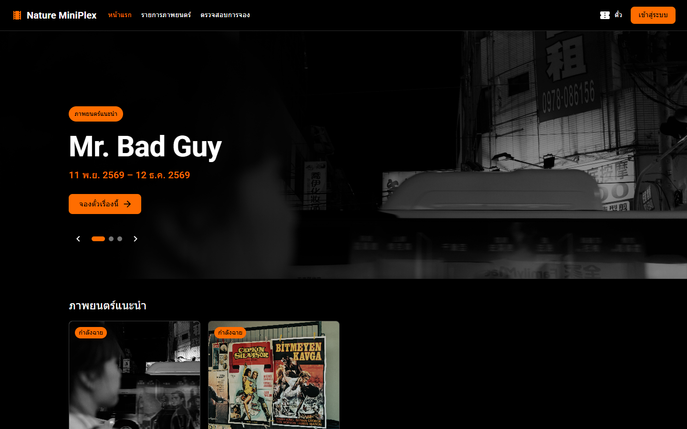
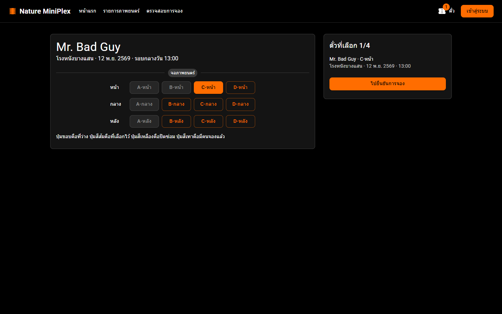
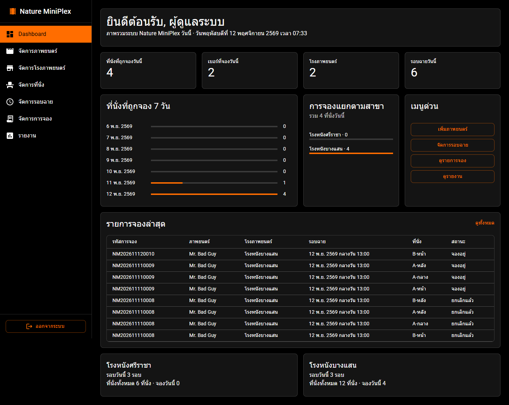

# Nature MiniPlex

เว็บจองตั๋วหนังสองฝั่ง ลูกค้าเลือกเรื่อง โรง รอบ และที่นั่งด้วยเบอร์โทร พนักงานเข้าสู่ระบบเพื่อจัดรอบและดูรายงาน

React · Material UI · ASP.NET Core · Entity Framework Core · SQL Server Express



## ภาพรวม

| ลูกค้า | พนักงาน |
|---|---|
| ดูเรื่องแนะนำและเรื่องที่กำลังฉาย | เพิ่มเรื่อง อัปโหลดโปสเตอร์ และติ๊กเรื่องแนะนำ |
| เลือกสาขา รอบ และที่นั่งได้ 1–4 ที่ | เพิ่มโรงได้สองผัง คือ 6 ที่นั่งกับ 12 ที่นั่ง |
| จองข้ามรอบได้ในการจองครั้งเดียว | จัดรอบได้ไม่เกิน 3 รอบต่อโรงต่อวัน |
| ค้นและยกเลิกด้วยเบอร์โทร | ปิดที่นั่งซ่อม ยืนยันเริ่มฉาย และดูรายงานสด |

หนึ่งโรงใช้สี่เวลาตายตัว คือ 10:00, 13:00, 16:00 และ 20:00 จึงไม่มีรอบที่เวลาชนกัน ลูกค้าไม่ต้องสมัครสมาชิก ปุ่มเข้าสู่ระบบบนหัวเว็บเป็นของพนักงาน

<table>
  <tr>
    <td width="50%"></td>
    <td width="50%"></td>
  </tr>
</table>

## รันในเครื่อง

ใช้ .NET SDK 10, Node.js 20 ขึ้นไป และ Docker Desktop เปิด Docker ให้พร้อมก่อน แล้วรันจากโฟลเดอร์ที่มี `docker-compose.yml`

```bash
docker compose up -d
dotnet run --project src/NatureMiniPlex.Web --launch-profile http
```

เปิดอีกเทอร์มินัลสำหรับหน้าเว็บ

```bash
cd frontend
npm install
npm run dev
```

| | |
|---|---|
| เว็บ | http://localhost:5173 |
| Swagger | http://localhost:5274/swagger |
| พนักงาน | `admin` / `Admin@1234` |
| เบอร์ตัวอย่าง | `0891111111` |

ครั้งแรกที่เปิด API โปรแกรมสร้างฐานข้อมูลให้เอง พร้อมโรงศรีราชา โรงบางแสน และรอบตัวอย่างห้าวันแรก โปสเตอร์ไม่อยู่ใน Git อัปโหลดได้จากเมนูจัดการภาพยนตร์ รหัสใน repo นี้ใช้เปิดเครื่องพัฒนาเท่านั้น

ถ้าหน้าเว็บไม่ขึ้น ให้เช็กว่า API ฟังอยู่ที่พอร์ต `5274` และ Vite อยู่ที่ `5173` ถ้าพอร์ต `1433` ถูกใช้แล้ว เปลี่ยนพอร์ตใน `docker-compose.yml` กับสายเชื่อมใน `appsettings.json` ให้ตรงกัน

## โครงโค้ด

```text
frontend/                    หน้าเว็บ  ลูกค้าอยู่ใน pages/customer  พนักงานอยู่ใน pages/admin
src/NatureMiniPlex.Web/      API  แยกเป็น Controllers, Services, Models, DTOs, Data
tests/NatureMiniPlex.Tests/  เทสกติกา ใช้ฐานคนละก้อน
```

กติกาอยู่ที่ Service หน้าเว็บทำหน้าที่ส่งคำขออย่างเดียว รายละเอียดตาราง ลำดับการจอง และจุดที่จะแก้ต่ออยู่ใน [docs/DESIGN.md](docs/DESIGN.md)

```bash
dotnet test tests/NatureMiniPlex.Tests/NatureMiniPlex.Tests.csproj
```
