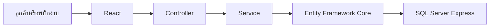
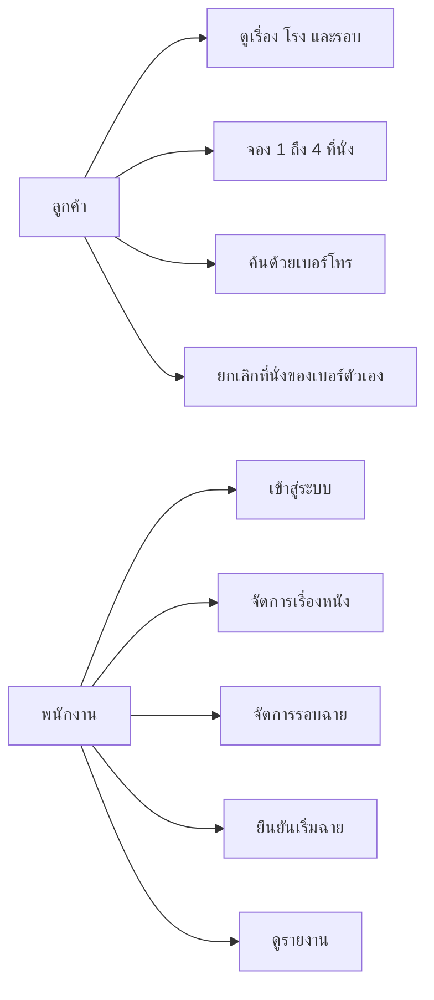
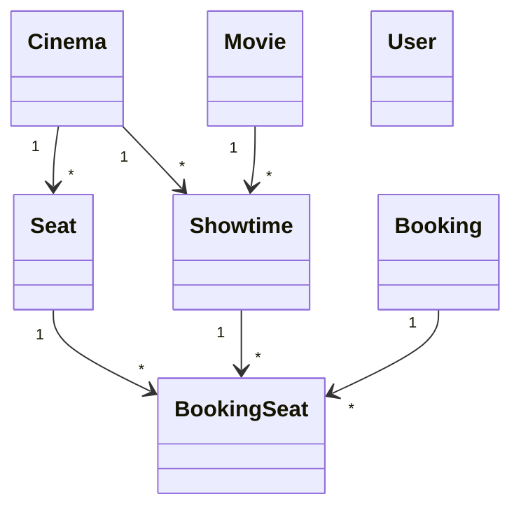
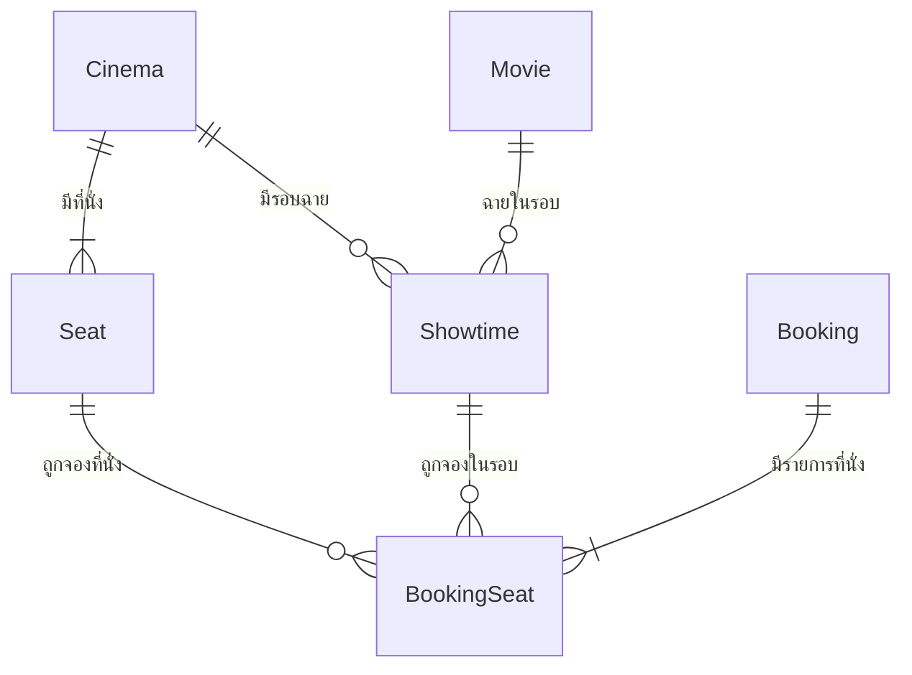
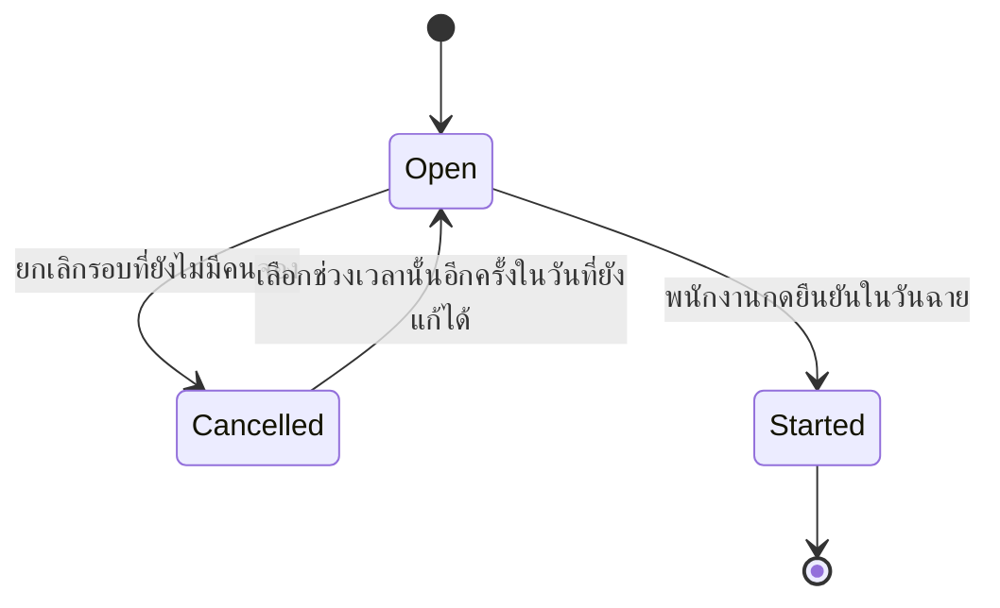
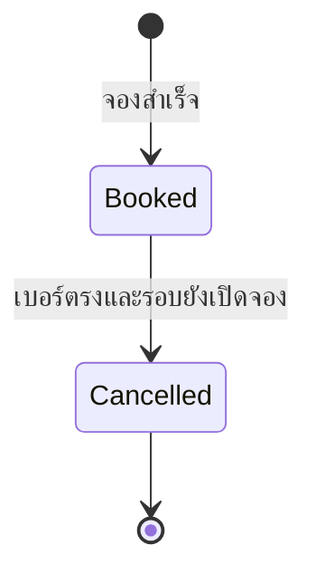
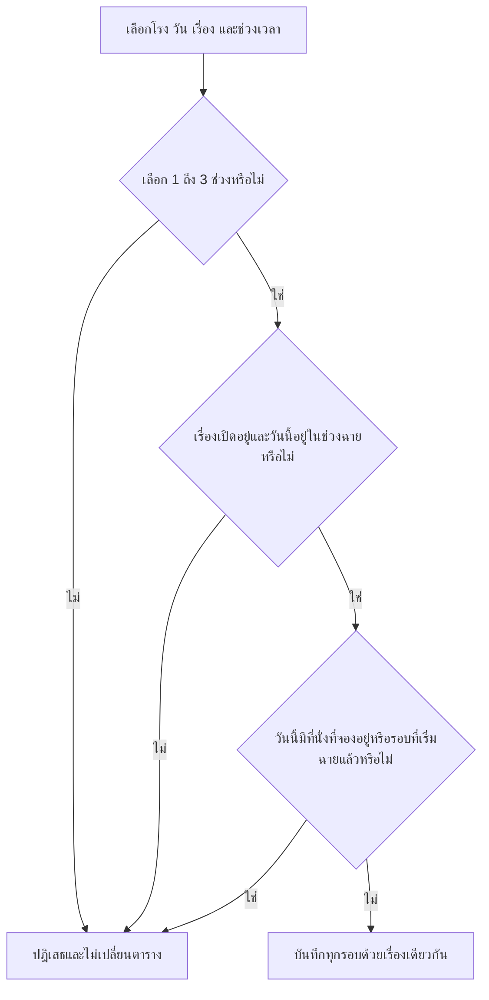
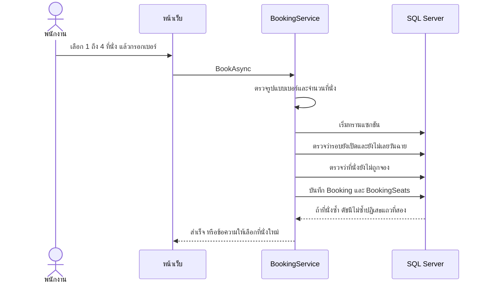
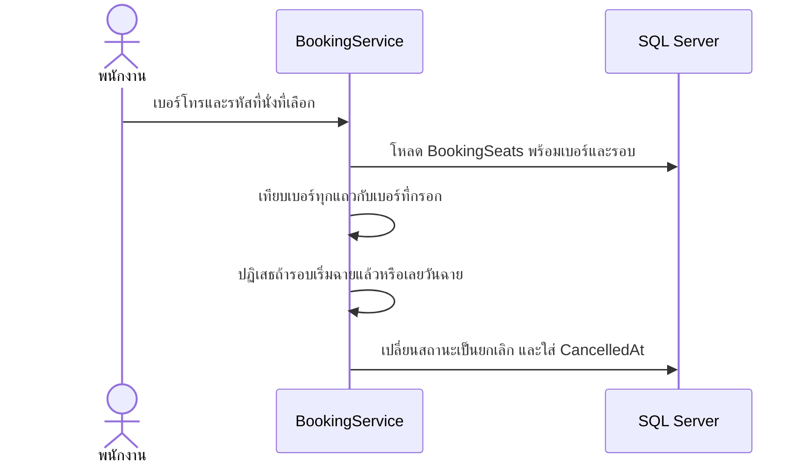
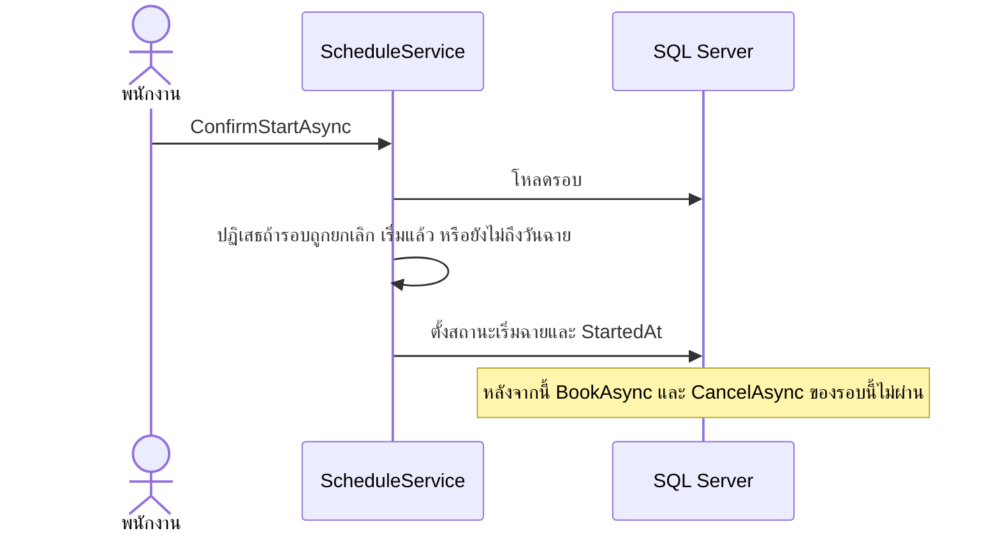

# เอกสารออกแบบ Nature MiniPlex

เอกสารนี้ใช้คำเดียวกับโค้ด มีสองฝั่ง ลูกค้าจองเองด้วยเบอร์โทรโดยไม่ต้องสมัครสมาชิก พนักงานเข้าสู่ระบบแล้วจัดการเรื่อง รอบฉาย และรายงาน หน้าแรกเลื่อนเรื่องที่กำลังฉายเป็นสไลด์ โดยใช้โปสเตอร์ของเรื่องนั้นเป็นพื้นหลัง แล้วแยกการ์ดเป็นภาพยนตร์แนะนำ ภาพยนตร์ที่กำลังฉาย รอบฉายวันนี้ และสาขา หน้าสาขาแสดงเรื่องที่กำลังฉาย พร้อมรอบของสาขานั้น

## เครื่องมือ

| ส่วน | เครื่องมือ |
|---|---|
| หน้าเว็บ | React, JSX และ Material UI ผ่าน Vite ไม่ใช้ TypeScript |
| API | ASP.NET Core Web API บน .NET 10 และ Swagger |
| ล็อกอินพนักงาน | JWT จากแพ็กเกจของ ASP.NET Core ลูกค้าไม่ต้องล็อกอิน |
| กฎธุรกิจ | คลาสในโฟลเดอร์ `Services` |
| ฐานข้อมูล | Entity Framework Core 10.0.7 แบบ Code First |
| เซิร์ฟเวอร์ฐานข้อมูล | SQL Server 2022 Express ใน Docker ตั้ง `MSSQL_PID=Express` |
| รายการที่นั่งที่ยังไม่กดยืนยัน | state ของ React ในเบราว์เซอร์ลูกค้า |
| เทส | xUnit |

ชั้นของโปรแกรมเป็นเส้นตรง



Controller รับ JSON แล้วเรียก Service Service เป็นที่เดียวที่ตัดสินว่าบันทึกได้หรือไม่ได้ หน้าเว็บไม่ใช่ที่กันที่นั่งซ้ำ

## โครงโฟลเดอร์

```text
src/NatureMiniPlex.Web/
  Controllers/     API ของเรื่อง โรง รอบ การจอง รายงาน และล็อกอิน
  Services/        กติกา
  Models/          คลาสตารางและค่าที่ส่งให้หน้าเว็บ
  DTOs/            รูปแบบ JSON ที่รับเข้ามา
  Data/            DbContext, migration, ข้อมูลเริ่มต้น
frontend/src/
  pages/customer/  หน้าจองตั๋ว
  pages/admin/     หน้าพนักงาน
  services/api.js  เรียก API
tests/NatureMiniPlex.Tests/BookingRuleTests.cs
docs/DESIGN.md
```

## กติกาธุรกิจ

1. ผังมีสองแบบ แบบ 6 ที่นั่งเป็นคอลัมน์ A B C และแถวหน้ากับหลัง แบบ 12 ที่นั่งเป็นคอลัมน์ A B C D และแถวหน้า กลาง หลัง ศรีราชาใช้แบบแรก บางแสนใช้แบบหลัง
2. พนักงานเพิ่มโรงได้โดยเลือกแบบผังอย่างใดอย่างหนึ่ง ระบบสร้างที่นั่งให้ทั้งผัง เปลี่ยนชื่อโรงได้ และปิดที่นั่งซ่อมได้ ปิดที่นั่งที่ถูกจองในรอบที่ยังเปิดอยู่ไม่ได้
3. เรื่องหนังมีวันเริ่มและวันสิ้นสุด วันสิ้นสุดรวมอยู่ในช่วงฉาย
4. หนึ่งโรงในหนึ่งวันมี 1 ถึง 3 รอบ จาก 4 ช่วง คือ เช้า กลางวัน เย็น ดึก
5. คนละรอบในวันเดียวกันเป็นคนละเรื่องได้ แต่โรงเดียวกันใช้ช่วงเวลาซ้ำไม่ได้ แต่ละช่วงมีเวลาตายตัว คือเช้า 10:00 กลางวัน 13:00 เย็น 16:00 ดึก 20:00 จึงไม่มีรอบที่เวลาชนกัน
6. วันที่ของรอบต้องอยู่ในช่วงของเรื่อง และเพิ่มย้อนหลังไม่ได้
7. แก้หรือยกเลิกรอบนั้นไม่ได้ ถ้ารอบนั้นมีที่นั่งที่ยังจองอยู่ หรือเริ่มฉายแล้ว รอบอื่นของวันเดียวกันยังจัดการได้
8. หนึ่งการจองใช้หนึ่งเบอร์โทร 10 หลักขึ้นต้นด้วย 0 ได้รหัสการจอง และเลือกได้ 1 ถึง 4 ที่นั่ง ข้ามรอบและข้ามเรื่องได้
9. ที่นั่งหนึ่งของรอบหนึ่งมีเจ้าของได้คนเดียว ถ้ายกเลิกแล้ว ที่นั่งนั้นจองใหม่ได้
10. ยกเลิกได้เฉพาะที่นั่งของเบอร์นั้น ระบบเทียบเบอร์จากฐานข้อมูล
11. เมื่อถึงวันฉาย พนักงานกดยืนยันเริ่มฉายได้ หลังจากนั้นรอบนั้นจองและยกเลิกไม่ได้
12. วันฉายผ่านไปแล้ว จองและยกเลิกไม่ได้ แม้ยังไม่ได้กดยืนยัน
13. ยกเลิกเรื่องหนังได้เมื่อไม่มีรอบของวันนี้หรือวันหน้าถูกจองหรือเริ่มฉาย รอบในอนาคตที่ยังว่างจะถูกยกเลิกตาม
14. รายงานอ่านจากฐานข้อมูลทุกครั้งที่เปิดหน้า

รายการที่นั่งระหว่างเลือกอยู่ในเบราว์เซอร์ของลูกค้า ยังไม่ใช่การจอง การจองเกิดตอนกดยืนยัน แล้ว `BookingService.BookAsync` ตรวจฐานข้อมูลอีกครั้ง โจทย์บอกว่าแต่ละโรงต้องมีอย่างน้อย 1 รอบต่อวัน แต่ปฏิทินไม่มีวันสิ้นสุด ระบบจึงบังคับเพดาน 3 รอบเมื่อมีการเพิ่มรอบ ไม่ได้สร้างรอบว่างให้ทุกวันในอนาคตเอง

## Use case



| Use case | ทำอะไร | เมธอด |
|---|---|---|
| จัดการเรื่องหนัง | เพิ่ม แก้ไข อัปโหลดโปสเตอร์ ยกเลิก | `MovieService` และ `PosterFiles` |
| จัดการโรง | เพิ่มโรงตามผัง เปลี่ยนชื่อ และลบโรงที่ยังไม่มีรอบฉาย | `CinemaService` |
| จัดการที่นั่ง | ปิดซ่อมหรือเปิดใช้ที่นั่งในผังเดิม | `CinemaService.SetSeatClosedAsync` |
| จัดการรอบฉาย | เพิ่มทีละรอบ ไม่เกิน 3 รอบต่อโรงต่อวัน | `ScheduleService.CreateAsync` |
| จองตั๋ว | บันทึก 1 ถึง 4 ที่นั่งด้วยหนึ่งเบอร์ | `BookingService.BookAsync` |
| ตรวจการจอง | ค้นด้วยเบอร์โทรอย่างเดียว | `BookingService.FindAsync` |
| ยกเลิกตามเบอร์ | ยกเลิกบางที่นั่งของเบอร์นั้น | `BookingService.CancelAsync` |
| เข้าสู่ระบบพนักงาน | ตรวจรหัสแล้วออก JWT | `AuthService.LoginAsync` |
| ยืนยันเริ่มฉาย | ปิดรอบนั้น | `ScheduleService.ConfirmStartAsync` |
| ดูรายงาน | สรุปรอบ เรื่อง และรายการจอง | `ReportService.BuildAsync` |

## Class



คลาสอยู่ใน `Models/Entities.cs` สถานะและชื่อรอบภาษาไทยอยู่ใน `Models/Enums.cs`

## ฐานข้อมูล



ความสัมพันธ์เป็น Restrict จึงลบโรง เรื่อง หรือรอบทิ้งไม่ได้ถ้ายังมีแถวลูก ระบบเปลี่ยนสถานะแทนการลบประวัติ

### พจนานุกรมข้อมูล

**Cinemas**

| คอลัมน์ | ชนิด | ความหมาย |
|---|---|---|
| CinemaId | int | คีย์หลัก |
| CinemaName | nvarchar(100) | ชื่อโรง |
| ColumnCount | int | จำนวนคอลัมน์ |
| RowCount | int | จำนวนแถว |

**Seats**

| คอลัมน์ | ชนิด | ความหมาย |
|---|---|---|
| SeatId | int | คีย์หลัก |
| CinemaId | int | โรง |
| SeatRow | nvarchar(20) | หน้า กลาง หรือ หลัง |
| SeatColumn | nvarchar(1) | A B C หรือ D |
| SeatCode | nvarchar(20) | เช่น `A-หน้า` ไม่ซ้ำในโรงเดียวกัน |
| IsClosed | bit | 1 คือปิดซ่อม จองไม่ได้ |

**Movies**

| คอลัมน์ | ชนิด | ความหมาย |
|---|---|---|
| MovieId | int | คีย์หลัก |
| Title | nvarchar(200) | ชื่อเรื่อง |
| PosterFileName | nvarchar(80) | ชื่อไฟล์โปสเตอร์ ว่างได้ ตัวรูปอยู่ที่ `wwwroot/posters` |
| StartDate | date | วันเริ่มฉาย |
| StopDate | date | วันสิ้นสุด รวมวันนี้ |
| IsRecommended | bit | 1 คือภาพยนตร์แนะนำบนหน้าแรก พนักงานเป็นคนเลือก |
| Status | int | 0 เปิดอยู่, 1 ยกเลิกแล้ว |

**Showtimes**

| คอลัมน์ | ชนิด | ความหมาย |
|---|---|---|
| ShowtimeId | int | คีย์หลัก |
| CinemaId | int | โรง |
| MovieId | int | เรื่องที่ฉายในรอบนี้ |
| ShowDate | date | วันที่ฉาย |
| Slot | int | 1 เช้า 10:00, 2 กลางวัน 13:00, 3 เย็น 16:00, 4 ดึก 20:00 |
| StartTime | time | เวลาของช่วงนั้น |
| Status | int | 0 เปิดจอง, 1 ยกเลิกรอบ, 2 เริ่มฉายแล้ว |
| StartedAt | datetime2 | เวลาที่กดยืนยันเริ่มฉาย ว่างได้ |

โรงเดียวกัน วันเดียวกัน และช่วงเวลาเดียวกันมีได้แถวเดียว จากดัชนี `IX_Showtimes_CinemaId_ShowDate_Slot`

**Bookings**

| คอลัมน์ | ชนิด | ความหมาย |
|---|---|---|
| BookingId | int | คีย์หลัก |
| BookingCode | nvarchar(40) | รหัสการจอง ไม่ซ้ำ รูปแบบ `NM` ตามด้วยวันและเลขใบจอง |
| PhoneNumber | nvarchar(10) | เบอร์หลักฐานการจอง |
| BookedAt | datetime2 | เวลาที่กดยืนยัน |

ไม่มีสถานะที่ใบจอง เพราะยกเลิกได้บางที่นั่ง สถานะอยู่ที่ `BookingSeats`

**BookingSeats**

| คอลัมน์ | ชนิด | ความหมาย |
|---|---|---|
| BookingSeatId | int | คีย์หลัก |
| BookingId | int | ใบจอง |
| ShowtimeId | int | รอบ |
| SeatId | int | ที่นั่ง |
| Status | int | 0 จองอยู่, 1 ยกเลิกแล้ว |
| CancelledAt | datetime2 | เวลายกเลิก ว่างได้ |

**Users** มีเฉพาะพนักงาน คอลัมน์คือ UserId, Username, PasswordHash และ Role ลูกค้าไม่มีแถวในตารางนี้

## State

รอบฉาย



รายการที่นั่ง



แถวที่ยกเลิกไม่ถูกลบ ที่นั่งจึงมีประวัติ และจองใหม่ได้ด้วยแถวใหม่

## Activity การบันทึกรอบ



กฎ “1 ถึง 3 รอบ” นับข้ามหลายแถว จึงอยู่ใน `ScheduleService` ไม่ได้เป็น CHECK ของแถวเดียว

## Sequence การจอง



## Sequence การยกเลิก



## Sequence การเริ่มฉาย



## ไวยากรณ์จุดซับซ้อน

### 1. ที่นั่งเดียวกันในรอบเดียวกันจองซ้ำไม่ได้

อยู่ใน `Data/AppDbContext.cs` ดัชนีไม่ซ้ำมีเงื่อนไขเฉพาะแถวที่ `Status = 0` ซึ่งคือสถานะจองอยู่

```csharp
entity.HasIndex(item => new { item.ShowtimeId, item.SeatId })
    .IsUnique()
    .HasFilter("[Status] = 0");
```

แถวที่ยกเลิกแล้วมี `Status = 1` จึงไม่อยู่ในดัชนีนี้ ที่นั่งเดิมจึงจองใหม่ได้ด้วยแถวใหม่ ส่วนประวัติการยกเลิกยังอยู่

การตรวจใน C# กันกรณีปกติ ดัชนีกันกรณีสองคนกดพร้อมกัน คนที่บันทึกทีหลังได้ `DbUpdateException`

### 2. จองหลายที่นั่งในครั้งเดียว

อยู่ใน `Services/BookingService.cs` เมธอด `BookAsync`

- เบอร์ต้องเป็นตัวเลข 10 หลักขึ้นต้นด้วย 0
- หลังตัดที่นั่งซ้ำในคำขอเดียวกัน ต้องเหลือ 1 ถึง 4 ที่นั่ง
- ทั้งใบจองอยู่ในทรานแซกชันเดียว ถ้าที่นั่งใดที่หนึ่งใช้ไม่ได้ จะยกเลิกทั้งใบ
- ถ้าฐานข้อมูลชนดัชนีไม่ซ้ำ เมธอดจับ `DbUpdateException` แล้วคืนข้อความว่าที่นั่งถูกจองไปแล้ว

รายการในเบราว์เซอร์เป็นแค่ที่นั่งที่ลูกค้ากำลังเลือก ถ้าคนอื่นจองที่นั่งนั้นไปก่อนกดยืนยัน เมธอดนี้จะไม่บันทึก หลังบันทึกสำเร็จระบบใส่ `BookingCode` จากวันและ `BookingId`

### 3. ยกเลิกได้เฉพาะเบอร์เจ้าของ

อยู่ในเมธอด `CancelAsync` ของไฟล์เดียวกัน ระบบโหลดแถวจากฐานข้อมูลแล้วเทียบ `Booking.PhoneNumber` กับเบอร์ที่กรอก ถ้ามีแถวของเบอร์อื่นปนมา การยกเลิกทั้งชุดไม่เกิดขึ้น การแก้เลข `BookingSeatId` บนฟอร์มจึงยกเลิกของคนอื่นไม่ได้

เมธอดเดียวกันปฏิเสธเมื่อรอบไม่ได้อยู่ในสถานะเปิดจอง หรือวันฉายผ่านไปแล้ว

### 4. ไม่ให้รอบเวลาชนกัน และไม่สร้างรอบซ้ำ

อยู่ใน `ScheduleService.CreateAsync`

แต่ละรอบเลือกเรื่องของตัวเองได้ ตราบใดที่วันที่อยู่ในช่วงฉายของเรื่องนั้น โรงเดียวกันในหนึ่งวันเพิ่มได้ไม่เกิน 3 รอบ และใช้ช่วงเวลาซ้ำไม่ได้

ดัชนีของ Showtimes ไม่มีเงื่อนไขสถานะ รอบที่ยกเลิกแล้วยังกินชื่อโรง วัน และช่วงเวลานั้นอยู่ ถ้าจะเปิดช่วงเวลาเดิมอีกครั้ง โค้ดจึงหาแถวเดิมแล้วเปลี่ยนสถานะกลับเป็นเปิดจอง แทนการเพิ่มแถวใหม่

`SaveDayAsync` ยังอยู่สำหรับเทสชุดเดิมที่บันทึกหลายช่วงในครั้งเดียว หน้าเว็บพนักงานใช้ `CreateAsync`

## รายงาน

`ReportService.BuildAsync` คำนวณตอนเปิดหน้า

- แต่ละรอบแสดงจำนวนที่นั่งที่สถานะยังจองอยู่ เทียบกับจำนวนที่นั่งของโรง และสถานะของรอบ
- สรุปตามเรื่องคือผลรวมของที่นั่งที่ยังจองอยู่ในช่วงวันที่ที่เลือก
- ถ้าไม่กรอกเบอร์ จะเห็นเฉพาะที่นั่งที่ยังจองอยู่ ถ้ากรอกเบอร์ จะเห็นทั้งที่ยังจองและที่ยกเลิกของเบอร์นั้น

ไม่มีคอลัมน์ราคา เพราะโจทย์ไม่ได้กำหนดราคาตั๋ว

## เทส

`BookingRuleTests` เรียก Service ตรงและใช้ SQL Server จริง จึงตรวจดัชนีไม่ซ้ำได้ด้วย 14 กรณี

- จองที่ว่างสำเร็จ
- จองที่นั่งที่ถูกจองแล้วไม่ได้
- จองเกิน 4 ที่นั่งไม่ได้
- จองข้ามรอบได้
- จองข้ามเรื่องได้
- ยกเลิกด้วยเบอร์ไม่ตรงไม่ได้
- ยกเลิกหลังเริ่มฉายไม่ได้
- จองหลังเริ่มฉายไม่ได้
- เพิ่มรอบวันที่ห้าเกิน 3 รอบไม่ได้
- เพิ่มรอบนอกช่วงวันที่ของเรื่องไม่ได้
- สองคำขอจองที่เดียวกันพร้อมกัน ผ่านได้คำขอเดียว
- ยกเลิกด้วยเบอร์ตรงแล้ว ที่นั่งนั้นจองใหม่ได้
- เลยวันฉายแล้วจองไม่ได้
- สองเรื่องฉายโรงเดียวกันในวันเดียวกันได้ ถ้ารอบที่สี่จะไม่ผ่าน

## ข้อมูลตัวอย่าง

ตอนเปิดเว็บครั้งแรก ถ้ายังไม่มีเรื่องหนัง ระบบใส่ตัวอย่างตามแพทเทิร์นในโจทย์ เรื่องทั้งหมดฉายตั้งแต่วันที่เปิดโปรแกรมไปอีก 21 วัน และทั้งสองโรงมีรอบเปิดจองห้าวันแรก วันละ 3 รอบ เพิ่มเรื่องสมมติอีกสามเรื่องเพื่อให้แถวโปสเตอร์ดูเป็นหน้าจองตั๋ว ชื่อเรื่องสมมติไม่ใช่ข้อกำหนดใหม่

- ศรีราชาฉาย Mr. Nice Guy วันนี้รอบเช้ากับเย็น พรุ่งนี้รอบเช้า กลางวัน และเย็น
- บางแสนฉาย Mr. Bad Guy วันนี้รอบดึก พรุ่งนี้รอบกลางวันกับเย็น
- ที่นั่ง `A-หน้า` ของศรีราชา รอบเช้าวันนี้ ถูกจองด้วยเบอร์ `0891111111`
- พนักงานตัวอย่างชื่อ `admin` รหัส `Admin@1234` ใช้ได้เฉพาะหน้าจัดการ

## สิ่งที่ตั้งใจไม่ใส่

ไม่มีบัญชีลูกค้า ไม่มีราคาตั๋ว และไม่มีหน้าออกแบบผังที่นั่งใหม่ พนักงานเพิ่มโรงได้แค่สองผังตามโจทย์ และปิดที่นั่งซ่อมได้ ลูกค้าใช้เบอร์โทรเป็นหลักฐาน การเข้าสู่ระบบมีเฉพาะพนักงาน พนักงานอัปโหลดโปสเตอร์เองได้ ระบบเก็บไฟล์รูปไว้ที่ `wwwroot/posters` และเก็บแค่ชื่อไฟล์ในตาราง Movies ไม่ใส่ไฟล์รูปลงฐานข้อมูล และไม่ใส่โปสเตอร์ลิขสิทธิ์มาให้

วันที่ในช่องกรอกเป็น ค.ศ. ตามมาตรฐานของช่อง `date` วันที่ในตารางเป็น พ.ศ. ผ่าน `ThaiDate` วัฒนธรรมของเว็บเป็น `th-TH` แต่ตัดปฏิทินพุทธศักราชออกใน `Program.cs` ไม่งั้นช่องวันที่จะกลายเป็นปี 2569 และบันทึกรอบผิดวัน

